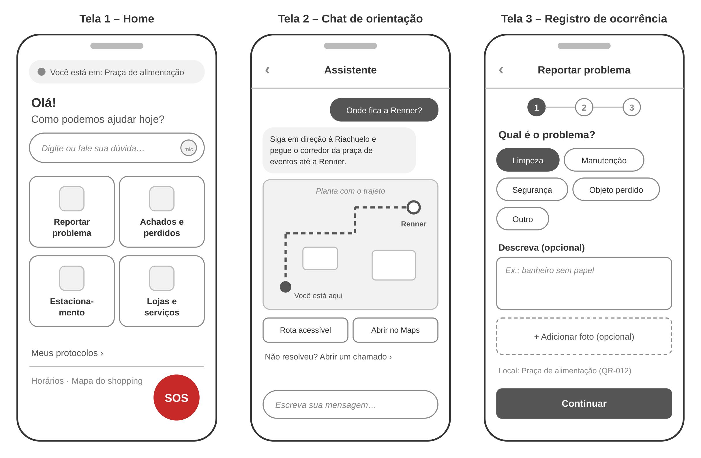
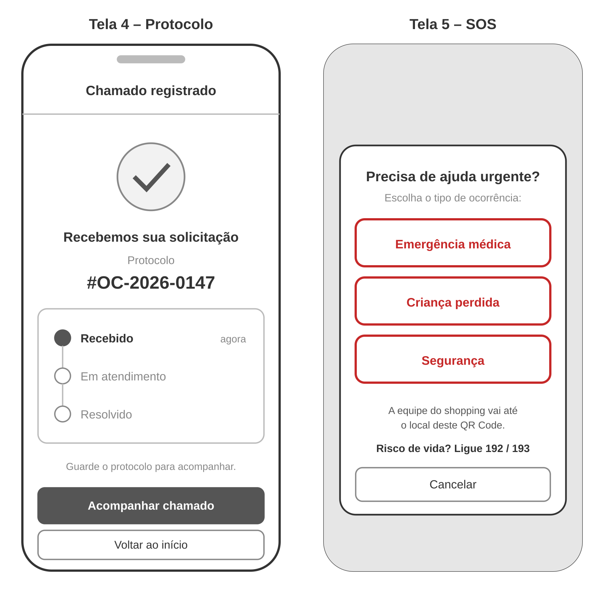
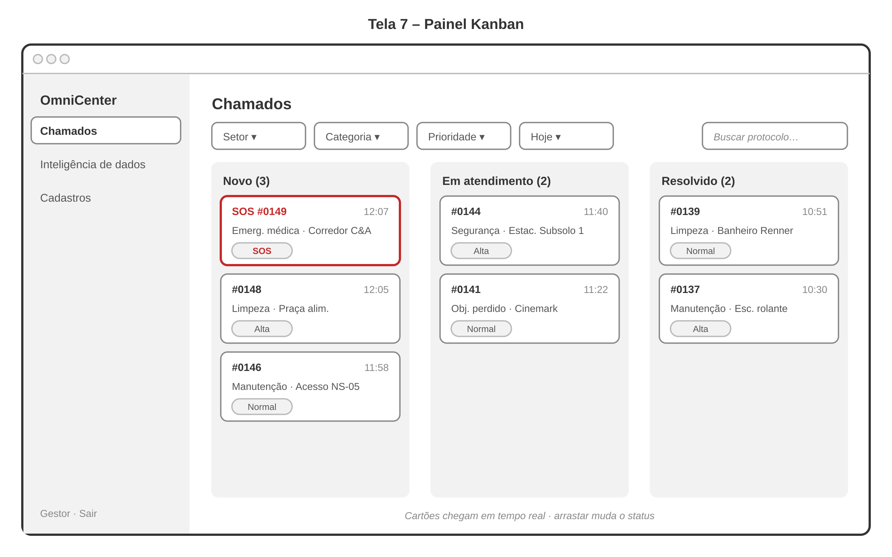
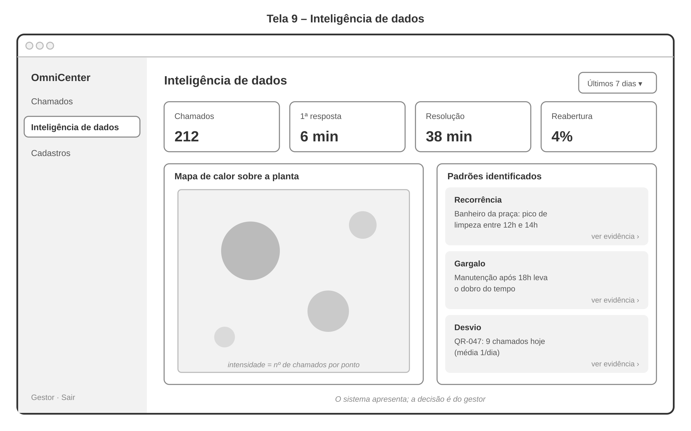
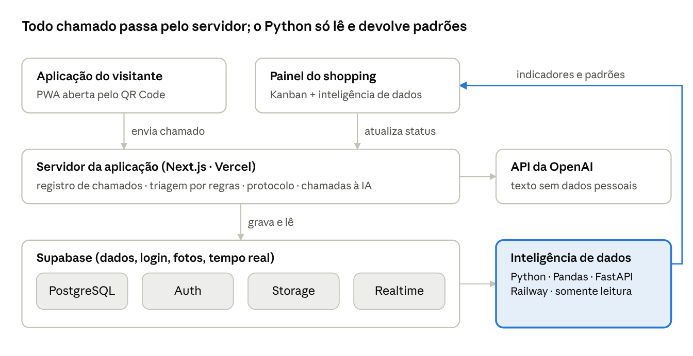

# OmniCenter – Hub Integrado de Experiência Phygital

> **HackaRun · Desafio 07 – Atendimento e experiência de serviços · Primeira entrega**
> Planejamento técnico inicial – 13 de novembro de 2026 · **Equipe: Crobat**

O **OmniCenter** é uma aplicação web acessada por QR Code. Ela reúne orientações, reclamações e situações inesperadas dos visitantes e entrega cada chamado ao setor certo do shopping em tempo real.

"Phygital" porque o QR Code liga um local físico do shopping a um serviço digital que já sabe onde o visitante está.

> **Nota:** esta é a primeira entrega, de planejamento e definição técnica. **Não é** a entrega final do MVP.

---

## 📑 Sumário

| # | Item da entrega | Seção |
|---|---|---|
| 1 | Documentação inicial do projeto | [§1](#1-documentação-inicial-do-projeto) |
| 2 | Proposta e estrutura inicial das telas | [§2](#2-proposta-e-estrutura-inicial-das-telas) |
| 3 | Linguagem de programação escolhida | [§3](#3-linguagem-de-programação-escolhida) |
| 4 | Arquitetura proposta | [§4](#4-arquitetura-proposta) |
| 5 | Plataforma e tecnologias adotadas | [§5](#5-plataforma-e-tecnologias-adotadas) |
| 6 | Tecnologia sorteada: Miro | [§6](#6-incorporação-da-tecnologia-sorteada-miro) |

📄 **Documentação completa:** [`docs/OmniCenter_Planejamento_Tecnico_Inicial.md`](docs/OmniCenter_Planejamento_Tecnico_Inicial.md) · também disponível em [PDF](docs/OmniCenter_Planejamento_Tecnico_Inicial.pdf)

---

## 1. Documentação inicial do projeto

### 1.1 Desafio

- **Contexto:** os visitantes podem precisar de orientações, informações, registrar reclamações ou resolver situações inesperadas durante a permanência no shopping.
- **Problemática:** a experiência de atendimento é prejudicada quando as necessidades dos visitantes não são compreendidas ou resolvidas com agilidade.
- **Objetivo:** melhorar a experiência dos visitantes no acesso aos serviços e no relacionamento com o shopping.

### 1.2 Problemas que a solução ataca

- O visitante não sabe onde pedir ajuda e precisa encontrar fisicamente um balcão.
- As solicitações chegam por canais diferentes e se perdem entre as equipes.
- Ninguém sabe com clareza o status nem o responsável por cada chamado.
- A gestão não tem dados consolidados para enxergar recorrências e gargalos.

### 1.3 Objetivos e proposta de valor

**Objetivo geral:** criar um ponto de entrada digital único, contextualizado pelo local do QR Code e ligado a um fluxo operacional rastreável.

**Objetivos específicos:**

- Dar acesso aos serviços por QR Code, sem instalar aplicativo.
- Responder dúvidas frequentes e orientar rotas com um assistente virtual.
- Registrar ocorrências com categoria, descrição, local e foto opcional.
- Classificar e encaminhar chamados ao setor certo.
- Permitir que a equipe atualize o status e registre as providências.
- Fornecer um protocolo para o visitante acompanhar o chamado.
- Transformar os registros em informação para a tomada de decisão da gestão.

**Proposta de valor:** para o visitante, menos esforço para conseguir ajuda e para se orientar. Para o shopping, todas as demandas num só lugar, rastreáveis e convertidas em dados de gestão.

### 1.4 Perfis de usuário

| Perfil | O que faz | Acesso |
|---|---|---|
| **Visitante** | Consulta informações e rotas, registra ocorrências, aciona SOS e consulta protocolo | Aplicação pública, sem cadastro obrigatório |
| **Operador** | Assume chamados do seu setor, atualiza status e registra providências | Painel com login |
| **Gestor** | Distribui demandas, acompanha indicadores e recebe os resultados da inteligência de dados | Painel com permissões ampliadas |
| **Administrador** | Cadastra planta digital, pontos de QR Code, setores, categorias e usuários | Área restrita |

### 1.5 Escopo do MVP

**Entra no MVP:** acesso por QR Code com identificação do ponto, planta digital com cálculo de rota, home com atalhos, formulário de ocorrência com foto opcional, protocolo, triagem por regras com apoio de IA, fluxo de SOS, Kanban com estados *Novo*, *Em atendimento* e *Resolvido*, login da equipe e indicadores básicos do módulo de inteligência de dados.

**Fica para depois:** chat com base de conhecimento completa, notificações por WhatsApp/SMS, agrupamento de reclamações por assunto, análise de sentimento e previsão de demanda.

**Shopping piloto:** Capim Dourado Shopping (Palmas – TO), com uso da planta autorizado. O shopping é praticamente todo térreo — o único nível superior é a praça de alimentação e os subsolos 1 e 2 são estacionamento. Isso torna a planta digital viável já no MVP.

### 1.6 Requisitos funcionais (resumo)

| Código | Requisito | Código | Requisito |
|---|---|---|---|
| RF01 | Acesso por QR Codes vinculados a pontos físicos | RF09 | Painel Kanban: Novo, Em atendimento, Resolvido |
| RF02 | Interface responsiva com busca e atalhos | RF10 | Atualização de status e registro de providências |
| RF03 | Assistente virtual de dúvidas e rotas | RF11 | Fluxo de SOS com confirmação e prioridade máxima |
| RF04 | Registro de ocorrência (categoria, descrição, local) | RF12 | Consulta de andamento por protocolo |
| RF05 | Foto opcional com limite de formato/tamanho | RF13 | Histórico de alterações de cada chamado |
| RF06 | Protocolo único por chamado | RF14 | Filtros por categoria, setor, prioridade, status e período |
| RF07 | Classificação por categoria, prioridade e setor | RF15 | Indicadores e padrões para o gestor |
| RF08 | Atribuição e reatribuição de chamados | | |

### 1.7 Requisitos não funcionais

- **Usabilidade e acessibilidade:** botões grandes, bom contraste, textos legíveis e rótulos em todos os controles.
- **Desempenho:** a home abre rápido mesmo com sinal fraco de internet.
- **Segurança:** HTTPS, login para a equipe, permissões por perfil e chaves de API apenas no servidor.
- **Privacidade (LGPD – Lei 13.709/2018):** coleta mínima, sem cadastro do visitante, fotos com acesso restrito e prazo de retenção definido.
- **Rastreabilidade:** toda ação da equipe sobre um chamado fica registrada.
- **Resiliência:** se a IA estiver fora do ar, o visitante continua registrando chamados pelas categorias fixas.

**Premissa:** o OmniCenter apoia o atendimento e **não substitui** os serviços públicos de emergência. O SOS aciona o fluxo interno do shopping e orienta o visitante a ligar para o **192/193** quando for o caso.

---

## 2. Proposta e estrutura inicial das telas

São duas interfaces: a do **visitante**, pensada para o celular, e a do **shopping**, pensada para o computador. O visitante sempre entra pela leitura de um QR Code, e o ponto físico já vem identificado.

### 2.1 Interface do visitante (celular)

| Tela | Conteúdo principal |
|---|---|
| **Tela 1 – Home** | Nome do local lido no QR Code. Busca "Como podemos ajudar hoje?". Atalhos: Reportar problema, Achados e perdidos, Estacionamento, Lojas e serviços. Botão SOS vermelho fixo |
| **Tela 2 – Chat de orientação** | Conversa com o assistente em linguagem natural. Para localização, mostra a planta com o trajeto desenhado desde o QR Code lido. Botões "Rota acessível" e "Abrir no Google Maps" |
| **Tela 3 – Registro de ocorrência** | Três passos: categoria, descrição + foto (opcional), revisão e envio. O local vem preenchido pelo QR Code |
| **Tela 4 – Protocolo** | Confirmação com o número do protocolo e status atual; serve também para consultar chamados depois, com validação adicional |
| **Tela 5 – SOS** | Confirmação antes do envio (evita toques acidentais). Opções: Emergência médica, Criança perdida, Segurança. Orienta a ligar para 192/193 se necessário |

<p align="center"></p>
<p align="center"><em>Telas 1 a 3 do visitante</em></p>

<p align="center"></p>
<p align="center"><em>Telas 4 e 5 do visitante</em></p>

### 2.2 Interface do shopping (computador)

| Tela | Conteúdo principal |
|---|---|
| **Tela 6 – Login** | Acesso da equipe com e-mail corporativo; o que cada pessoa vê depende do perfil (operador, gestor, administrador) |
| **Tela 7 – Painel Kanban** | Colunas Novo, Em atendimento e Resolvido em tempo real. Cada cartão mostra protocolo, categoria, local, prioridade, setor e horário. SOS no topo, em vermelho. Filtros por setor, categoria, prioridade e período |
| **Tela 8 – Detalhe do chamado** | Descrição, foto, sugestão da IA e decisão final da equipe, responsável, observações internas, local na planta e histórico completo |
| **Tela 9 – Inteligência de dados** | Indicadores (volume, 1ª resposta, resolução, reaberturas), mapa de calor sobre a planta e lista de padrões identificados, cada um com a evidência que o sustenta |
| **Tela 10 – Cadastros** | Planta digital, pontos de QR Code (com geração do código para impressão), setores, categorias e usuários |

<p align="center"></p>
<p align="center"><em>Tela 7 – Painel Kanban</em></p>

<p align="center"></p>
<p align="center"><em>Tela 9 – Inteligência de dados</em></p>

> As telas 6 (Login), 8 (Detalhe do chamado) e 10 (Cadastros) seguem o mesmo padrão visual do painel. Os wireframes mostram estrutura e hierarquia, não o visual final; nomes de lojas, horários e números são ilustrativos.

### 2.3 Navegação principal

1. O visitante lê o QR Code e cai na **Home** já com o local identificado.
2. Pela **busca** ou pelo **chat**, resolve dúvidas e recebe rotas. Se não resolver, abre um chamado.
3. Pelo **registro de ocorrência**, envia o problema e recebe o **protocolo**.
4. O chamado aparece em tempo real no **Kanban**. Um operador o assume, atende e marca como resolvido.
5. Os registros acumulados alimentam a tela de **inteligência de dados**, que o gestor usa para decidir onde agir.

---

## 3. Linguagem de programação escolhida

O projeto usa duas linguagens, cada uma no que faz melhor: **TypeScript** para toda a operação e **Python** para a inteligência de dados.

### 3.1 TypeScript – operação

**Onde:** interface do visitante, painel do shopping e servidor da aplicação (registro de chamados, triagem, cálculo de rotas, chamadas à IA, protocolo).

**Por quê:**

- É a linguagem nativa do navegador: câmera, leitura de QR Code, envio de fotos e funcionamento como app (PWA) são simples e bem documentados.
- Uma única linguagem para interface e servidor, com definições de dados compartilhadas (chamado, setor, ponto).
- A tipagem detecta erros antes de rodar, reduzindo falhas na integração entre telas.
- Suporte direto à atualização em tempo real — essencial para o chamado aparecer no Kanban no mesmo instante.

### 3.2 Python – inteligência de dados

**Onde:** um serviço separado, de apoio à decisão. Ele coleta os dados, organiza, relaciona, identifica padrões e apresenta resultados ao gestor. **Não executa nenhuma ação sozinho:** não altera chamados, não muda escalas, não aciona equipes. Quem decide é sempre uma pessoa.

**Fonte de dados:** exclusivamente o que é registrado pela própria aplicação (chamados, histórico de status, pontos de QR Code, setores, SOS e perguntas ao assistente). Nenhuma fonte externa.

**Por quê:**

- É a linguagem de referência para tratamento e análise de dados (Pandas), estatística e aprendizado de máquina nas fases seguintes.
- Separar a análise da operação protege o fluxo principal: se o serviço de análise falhar, os chamados continuam funcionando.

**Exemplos de padrões apresentados ao gestor:**

- **Recorrência:** "O banheiro da praça de alimentação recebeu 14 chamados de limpeza na última semana, 70% entre 12h e 14h."
- **Gargalo:** "Chamados de manutenção abertos depois das 18h levam o dobro do tempo para serem resolvidos."
- **Reincidência:** "A escada rolante da praça de alimentação foi reaberta 3 vezes depois de marcada como resolvida."
- **Desvio fora do normal:** "O ponto QR-047 teve 9 chamados hoje, contra média de 1 por dia."

Com isso, o gestor decide a ação: reforçar a limpeza no horário de pico, rever o turno da noite ou acionar o fornecedor do equipamento.

> Os exemplos acima são ilustrativos. Os números reais virão dos registros da aplicação.

---

## 4. Arquitetura proposta

Arquitetura **cliente-servidor em nuvem, organizada em camadas**, com o módulo de inteligência de dados isolado da operação.

<p align="center"></p>
<p align="center"><em>Arquitetura do OmniCenter: clientes, servidor, dados e serviços de apoio</em></p>

As duas interfaces falam só com o servidor, e apenas ele grava no banco, calcula rotas e chama a IA. O Python lê os registros do banco e devolve indicadores e padrões ao painel do gestor.

### 4.1 Camadas

- **Clientes:** aplicação do visitante (PWA aberta pelo QR Code) e painel do shopping (Kanban, cadastros e inteligência de dados).
- **Servidor da aplicação:** valida dados, grava chamados, gera protocolos, aplica regras de triagem, calcula rotas na planta digital e é o único ponto que chama a IA.
- **Dados:** Supabase concentra banco (incluindo a planta digital), login da equipe, fotos e a atualização em tempo real do Kanban.
- **Serviços de apoio:** API de IA (interpretar texto) e serviço Python de inteligência de dados, que só lê.

### 4.2 Caminho de um chamado

1. O visitante lê o QR Code — a aplicação abre já sabendo o ponto físico.
2. Escolhe a categoria, descreve o problema e, se quiser, anexa uma foto.
3. O servidor valida, grava o chamado e devolve o protocolo.
4. **Triagem:** cada categoria tem um setor padrão. A IA sugere categoria e prioridade; a regra de negócio confirma o encaminhamento. Baixa confiança vai para fila de triagem manual. O SOS segue regra fixa, sem depender da IA.
5. O chamado aparece em tempo real no Kanban do setor responsável.
6. O operador assume, registra as providências e encerra — cada passo fica no histórico.

### 4.3 Orientação pela planta digital

- **A planta vira dados:** lojas, âncoras, praças, banheiros, elevadores, escadas, acessos, caixas eletrônicos, SAC e pontos de QR Code são cadastrados com nível e posição. Os corredores viram ligações marcadas como acessíveis ou não.
- **Como funciona:** a IA identifica o destino; o servidor calcula o menor caminho a partir do QR Code lido; a IA descreve o trajeto com referências do shopping; o visitante vê o percurso desenhado na planta.
- **A IA não inventa rotas:** ela só descreve a rota calculada pelo sistema.
- **Rota acessível:** caminho usando apenas elevadores e rampas, inclusive até a praça de alimentação.
- **Google Maps:** botão leva ao destino pelo GPS do celular e indica o acesso externo mais próximo.
- **Áreas internas:** depósitos e circulação de serviço não aparecem para o visitante; a localização da brigada é usada no SOS para acionar a equipe mais próxima.

### 4.4 Processamento da inteligência de dados

1. **Coletar:** lê os registros da aplicação com acesso somente de leitura, sem dados que identifiquem o visitante.
2. **Organizar:** padroniza categorias, horários e locais; descarta registros incompletos ou duplicados.
3. **Relacionar:** cruza local, horário, categoria, setor e tempo de resolução.
4. **Identificar padrões:** recorrências, gargalos, reincidências e desvios fora do normal.
5. **Apresentar:** entrega resultados na tela de inteligência de dados, cada um com a evidência que o sustenta.

### 4.5 Segurança e privacidade na arquitetura

- Chaves de API e credenciais ficam só no servidor, nunca no navegador.
- Regras de acesso por perfil aplicadas no próprio banco (Row Level Security).
- Fotos em armazenamento privado, abertas por links temporários.
- O Python acessa apenas visões do banco sem dados pessoais, com perfil somente de leitura.
- A IA recebe apenas o texto necessário para a triagem.
- Ações da equipe sobre os chamados ficam registradas para auditoria.

---

## 5. Plataforma e tecnologias adotadas

A stack usa um único serviço para dados e autenticação (**Supabase**), sem alternativas equivalentes em paralelo.

| Camada | Tecnologia adotada | Para que serve |
|---|---|---|
| Interface do visitante e painel | **Next.js + TypeScript + Tailwind CSS** | Telas do visitante (PWA) e do shopping no mesmo projeto, com rotas de servidor para operações protegidas |
| App sem instalação | **PWA** (manifesto + service worker) | Abre direto do QR Code no navegador, com opção de "adicionar à tela inicial" |
| QR Codes | Biblioteca **qrcode** | Cada código leva a um endereço com o identificador do ponto (ex.: `/p/QR-047`) |
| Planta digital e rotas | Pontos e ligações no **PostgreSQL** + algoritmo de menor caminho em **TypeScript** | Calcular o trajeto a partir do QR Code e desenhá-lo sobre a planta |
| Banco de dados | **Supabase – PostgreSQL** | Chamados, pontos, setores, usuários, planta digital e histórico, com RLS por perfil |
| Tempo real | **Supabase Realtime** | O chamado aparece no Kanban no instante em que o visitante envia |
| Login da equipe | **Supabase Auth** | Acesso por e-mail corporativo e perfis (operador, gestor, administrador) |
| Fotos | **Supabase Storage** | Armazenamento privado das fotos, com links temporários |
| Inteligência artificial | **API da OpenAI** (modelo de baixo custo) | Entender a pergunta do visitante e sugerir categoria, prioridade e setor — chamada só pelo servidor |
| Navegação externa | **Links do Google Maps** | Abrir o destino ou o acesso mais próximo no GPS do celular |
| Inteligência de dados | **Python + Pandas + FastAPI** | Processar os registros da aplicação e entregar indicadores e padrões ao painel |
| Gráficos no painel | **Recharts** | Indicadores e mapa de calor na tela de inteligência de dados |
| Hospedagem | **Vercel** (Next.js) e **Railway** (Python) | Publicação automática a cada atualização do código |
| Código e versionamento | **GitHub** | Repositório único, revisão de código e histórico |
| Planejamento visual | **Miro** | Ver [§6](#6-incorporação-da-tecnologia-sorteada-miro) |

### 5.1 Fases do módulo de inteligência de dados

| Fase | O que entrega | Por que nessa ordem |
|---|---|---|
| **1 – MVP** | Indicadores (volume, 1ª resposta, resolução, reabertura), mapa de calor por ponto de QR Code e padrões de recorrência, gargalo, reincidência e desvio | Funciona com poucas semanas de registros |
| **2** | Agrupamento de reclamações por assunto e análise de sentimento das descrições | Usa o serviço de IA já previsto |
| **3** | Previsão de demanda por local e horário, para dimensionar equipes | Só depois de acumular histórico real e validar o modelo |

**Para a demonstração:** um script em Python gera chamados simulados com a mesma estrutura dos registros reais. Alguns padrões são colocados de propósito nesses dados (por exemplo, o pico de chamados de limpeza num banheiro na hora do almoço), e a demo mostra o módulo encontrando esses padrões sozinho.

---

## 6. Incorporação da tecnologia sorteada: Miro

O **Miro** será o espaço de colaboração visual da equipe durante o planejamento e o desenvolvimento do OmniCenter. Nos quadros digitais, a equipe registra decisões, organiza ideias e representa graficamente os processos da solução.

**Aplicações previstas:**

- **Jornada do visitante:** da leitura do QR Code até a resolução do chamado, com os pontos de atrito que a solução elimina.
- **Fluxograma do chamado:** registro, triagem, distribuição, atendimento e encerramento, incluindo o caminho do SOS.
- **Mapa de funcionalidades e requisitos:** o que entra no MVP e o que fica para as fases seguintes.
- **Diagrama da arquitetura e das integrações.**
- **Quadro de tarefas:** responsáveis, prioridades e andamento ao longo do HackaRun.

O Miro é uma ferramenta de apoio ao planejamento e à comunicação da equipe, **não um componente executado dentro do produto**. Os quadros serão revisados ao longo do desenvolvimento para continuar alinhados ao que for implementado.

---

## 📂 Estrutura do repositório

```
OmniCenter/
├── README.md                                        ← este documento (resumo dos 6 itens)
├── planejamento.html                                ← versão visual do planejamento, com wireframes e explicações
├── .gitignore
├── docs/
│   ├── OmniCenter_Planejamento_Tecnico_Inicial.md   ← documentação técnica completa
│   └── OmniCenter_Planejamento_Tecnico_Inicial.pdf  ← mesma entrega em PDF
└── img/
    ├── arquitetura.png          ← diagrama de arquitetura
    ├── wf_visitante_a.png       ← wireframes telas 1 a 3 (visitante)
    ├── wf_visitante_b.png       ← wireframes telas 4 e 5 (visitante)
    ├── wf_visitante.png         ← visitante: todas as 5 telas em uma imagem
    ├── wf_kanban.png            ← wireframe tela 7 (Kanban)
    ├── wf_intel.png             ← wireframe tela 9 (Inteligência de dados)
    └── wf_shopping.png          ← shopping: telas 7 e 9 em uma imagem
```

## 📖 Como consultar a documentação

- **Nível resumo:** este `README.md`, com os 6 itens da primeira entrega.
- **Nível detalhado:** [`docs/OmniCenter_Planejamento_Tecnico_Inicial.md`](docs/OmniCenter_Planejamento_Tecnico_Inicial.md), com a versão completa (RFs detalhados, requisitos não funcionais, arquitetura e tecnologias).
- **Para enviar/imprimir:** [`docs/OmniCenter_Planejamento_Tecnico_Inicial.pdf`](docs/OmniCenter_Planejamento_Tecnico_Inicial.pdf).
