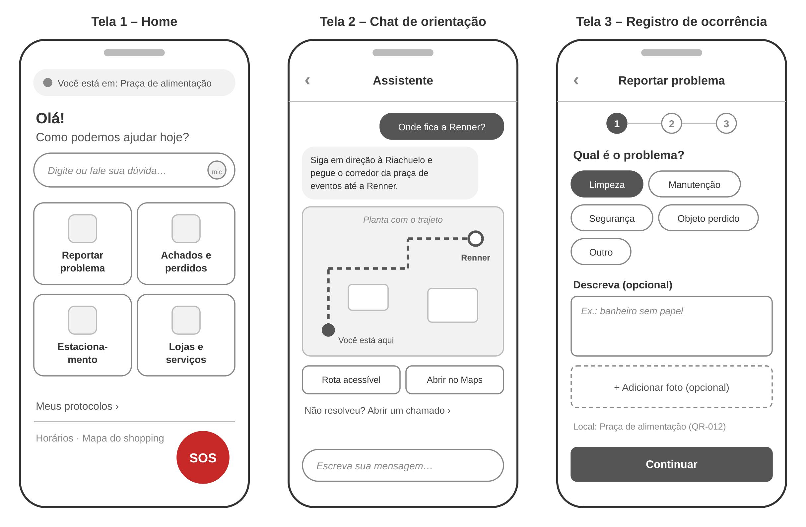
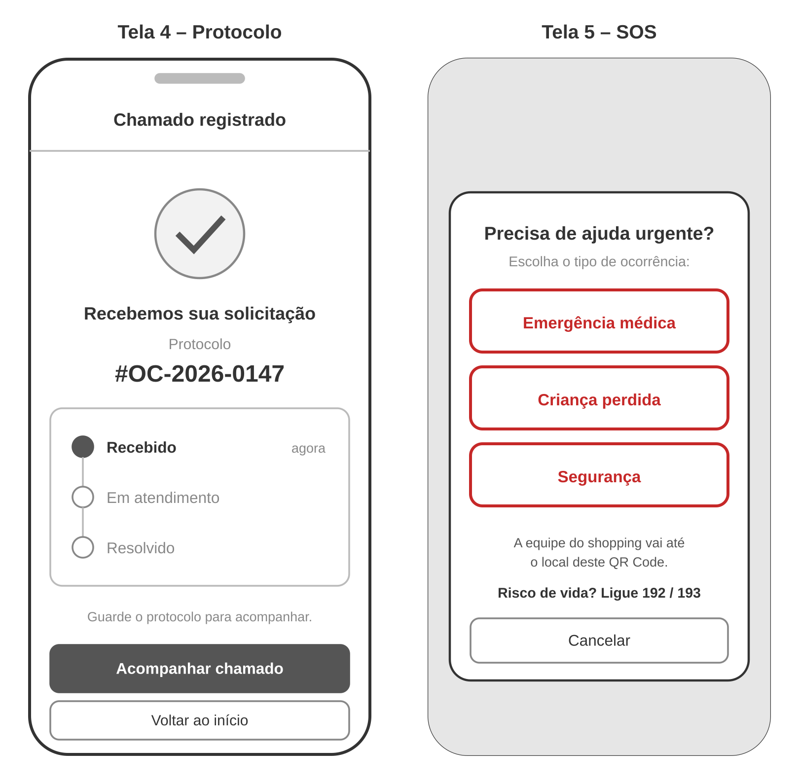
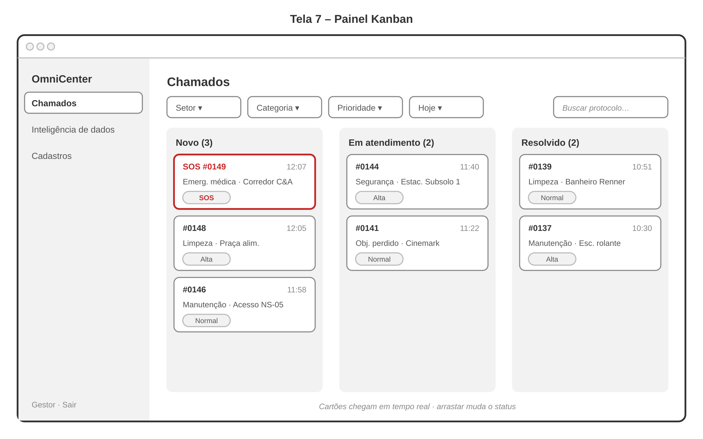
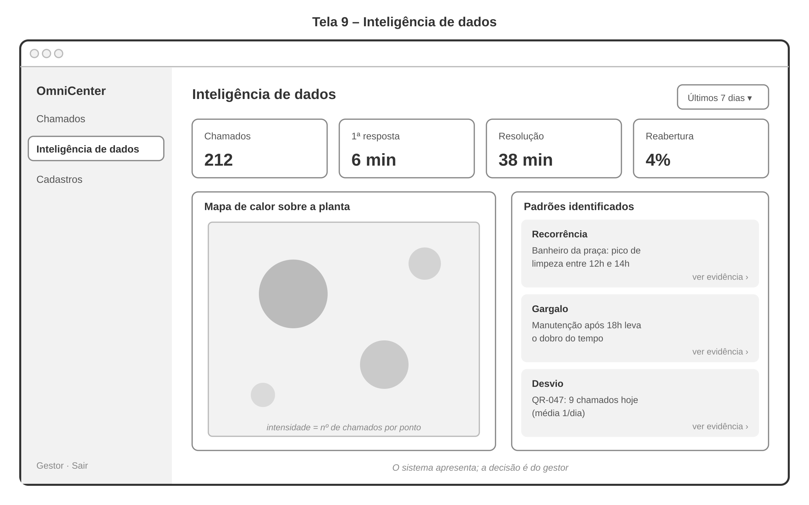
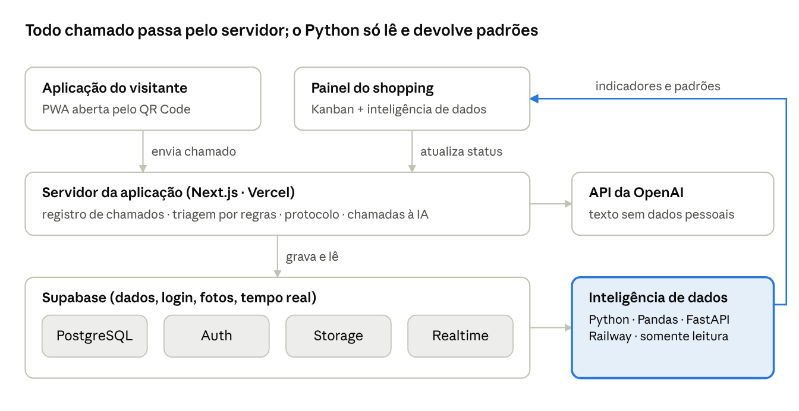

# OmniCenter – Planejamento Técnico Inicial

**HackaRun · Desafio 07 – Atendimento e experiência de serviços · Primeira entrega**  
13 de novembro de 2026

O OmniCenter é uma aplicação web acessada por QR Code. Ela reúne orientações, reclamações e situações inesperadas dos visitantes e entrega cada chamado ao setor certo do shopping em tempo real.

Este documento segue a ordem dos seis itens pedidos na primeira entrega (planejamento e definição técnica). Ele não é a entrega final do MVP.

**Equipe:** Crobat

## 1. Documentação inicial do projeto

**Nome da solução:** OmniCenter – Hub Integrado de Experiência Phygital. "Phygital" porque o QR Code liga um local físico do shopping a um serviço digital que já sabe onde o visitante está.

### 1.1 Desafio

- **Contexto:** os visitantes podem precisar de orientações, informações, registrar reclamações ou resolver situações inesperadas durante a permanência no shopping.
- **Problemática:** a experiência de atendimento é prejudicada quando as necessidades dos visitantes não são compreendidas ou resolvidas com agilidade.
- **Objetivo:** melhorar a experiência dos visitantes no acesso aos serviços e no relacionamento com o shopping.

### 1.2 Problemas que a solução ataca

- O visitante não sabe onde pedir ajuda e precisa encontrar fisicamente um balcão.
- As solicitações chegam por canais diferentes e se perdem entre as equipes.
- Ninguém sabe com clareza o status nem o responsável por cada chamado.
- A gestão não tem dados consolidados para enxergar recorrências e gargalos.

### 1.3 Objetivos e proposta de valor

**Objetivo geral:** criar um ponto de entrada digital único, contextualizado pelo local do QR Code e ligado a um fluxo operacional rastreável.

**Objetivos específicos:**

- dar acesso aos serviços por QR Code, sem instalar aplicativo;
- responder dúvidas frequentes e orientar rotas com um assistente virtual;
- registrar ocorrências com categoria, descrição, local e foto opcional;
- classificar e encaminhar chamados ao setor certo;
- permitir que a equipe atualize o status e registre as providências;
- fornecer um protocolo para o visitante acompanhar o chamado;
- transformar os registros em informação para a tomada de decisão da gestão.

**Proposta de valor:** para o visitante, menos esforço para conseguir ajuda e para se orientar. Para o shopping, todas as demandas num só lugar, rastreáveis e convertidas em dados de gestão.

### 1.4 Perfis de usuário

| Perfil | O que faz | Acesso |
|---|---|---|
| Visitante | Consulta informações e rotas, registra ocorrências, aciona SOS e consulta protocolo | Aplicação pública, sem cadastro obrigatório |
| Operador | Assume chamados do seu setor, atualiza status e registra providências | Painel com login |
| Gestor | Distribui demandas, acompanha indicadores e recebe os resultados da inteligência de dados | Painel com permissões ampliadas |
| Administrador | Cadastra planta digital, pontos de QR Code, setores, categorias e usuários | Área restrita |

### 1.5 Escopo do MVP e evolução

**Entra no MVP:** acesso por QR Code com identificação do ponto, planta digital do shopping com cálculo de rota, home com atalhos, formulário de ocorrência com foto opcional, protocolo, triagem por regras com apoio de IA, fluxo de SOS, Kanban com estados Novo, Em atendimento e Resolvido, login da equipe e indicadores básicos do módulo de inteligência de dados.

**Fica para depois:** chat com base de conhecimento completa, notificações por WhatsApp/SMS, agrupamento de reclamações por assunto, análise de sentimento e previsão de demanda.

**Shopping piloto:** Capim Dourado Shopping (Palmas – TO), com uso da planta autorizado. O shopping é praticamente todo térreo. O único nível superior é a praça de alimentação, e os subsolos 1 e 2 são estacionamento. Isso torna a planta digital viável já no MVP.

### 1.6 Requisitos funcionais

| Código | Requisito |
|---|---|
| RF01 | Acessar a plataforma por QR Codes vinculados a pontos físicos cadastrados |
| RF02 | Exibir interface responsiva com busca e atalhos para serviços |
| RF03 | Responder dúvidas e orientar rotas por meio de um assistente virtual, com base na planta digital do shopping |
| RF04 | Registrar ocorrência com categoria, descrição e local de referência |
| RF05 | Anexar foto opcional, com limite de formato e tamanho |
| RF06 | Gerar protocolo único para cada chamado |
| RF07 | Classificar chamados por categoria, prioridade e setor (regras + IA) |
| RF08 | Atribuir e reatribuir chamados a setores ou operadores |
| RF09 | Exibir painel Kanban com os estados Novo, Em atendimento e Resolvido |
| RF10 | Permitir que usuários autorizados atualizem o status e registrem providências |
| RF11 | Oferecer fluxo de SOS com confirmação, prioridade máxima e encaminhamento próprio |
| RF12 | Consultar o andamento pelo protocolo, com validação adicional |
| RF13 | Registrar o histórico de alterações de cada chamado |
| RF14 | Filtrar chamados por categoria, setor, prioridade, status e período |
| RF15 | Apresentar ao gestor indicadores e padrões identificados nos dados da aplicação |

### 1.7 Requisitos não funcionais

- **Usabilidade e acessibilidade:** botões grandes, bom contraste, textos legíveis e rótulos em todos os controles.
- **Desempenho:** a home deve abrir rápido mesmo com sinal fraco de internet.
- **Segurança:** HTTPS, login para a equipe, permissões por perfil e chaves de API apenas no servidor.
- **Privacidade (LGPD – Lei 13.709/2018):** coleta mínima, sem cadastro do visitante, fotos com acesso restrito e prazo de retenção definido. A análise de dados usa apenas informação sem identificação pessoal.
- **Rastreabilidade:** toda ação da equipe sobre um chamado fica registrada.
- **Resiliência:** se a IA estiver fora do ar, o visitante continua registrando chamados pelas categorias fixas.

**Premissa:** o OmniCenter apoia o atendimento e não substitui os serviços públicos de emergência. O SOS aciona o fluxo interno do shopping e orienta o visitante a ligar para o 192/193 quando for o caso.

## 2. Proposta e estrutura inicial das telas

São duas interfaces: a do visitante, pensada para o celular, e a do shopping, pensada para o computador. O visitante sempre entra pela leitura de um QR Code, e o ponto físico já vem identificado.

### 2.1 Interface do visitante (celular)

| Tela | Conteúdo principal |
|---|---|
| **Tela 1 – Home** | Nome do local lido no QR Code (ex.: "Praça de alimentação"). Busca "Como podemos ajudar hoje?". Atalhos: Reportar problema, Achados e perdidos, Estacionamento, Lojas e serviços. Botão SOS vermelho fixo no canto da tela |
| **Tela 2 – Chat de orientação** | Conversa com o assistente virtual em linguagem natural. Para pedidos de localização, mostra a planta com o trajeto desenhado desde o QR Code lido. O texto usa referências do shopping (âncoras, praças de eventos), e há os botões "Rota acessível" e "Abrir no Google Maps". Quando não sabe a resposta, o assistente avisa e oferece abrir um chamado |
| **Tela 3 – Registro de ocorrência** | Três passos: escolher a categoria, descrever e anexar foto (opcional), revisar e enviar. O local é preenchido automaticamente pelo QR Code |
| **Tela 4 – Protocolo** | Confirmação do registro com o número do protocolo e o status atual. Serve também para consultar um chamado depois, com validação adicional |
| **Tela 5 – SOS** | Confirmação antes do envio, para evitar toques acidentais. Opções: Emergência médica, Criança perdida, Segurança. Depois do envio, mostra que a equipe foi acionada e orienta a ligar para o 192/193 se for necessário |

**Wireframes de baixa fidelidade – visitante (celular)**

<em>Telas 1 a 3 do visitante</em>

<em>Telas 4 e 5 do visitante</em>

### 2.2 Interface do shopping (computador)

| Tela | Conteúdo principal |
|---|---|
| **Tela 6 – Login** | Acesso da equipe com e-mail corporativo. O que cada pessoa vê depende do perfil (operador, gestor, administrador) |
| **Tela 7 – Painel Kanban** | Colunas Novo, Em atendimento e Resolvido, atualizadas em tempo real. Cada cartão mostra protocolo, categoria, local, prioridade, setor e horário. Chamados SOS aparecem no topo e destacados em vermelho. Filtros por setor, categoria, prioridade e período |
| **Tela 8 – Detalhe do chamado** | Descrição, foto, sugestão da IA e decisão final da equipe, responsável, observações internas, local na planta e histórico completo de alterações |
| **Tela 9 – Inteligência de dados** | Indicadores (volume, tempo de primeira resposta, tempo de resolução, reaberturas), mapa de calor sobre a planta do shopping e lista de padrões identificados, cada um com a evidência que o sustenta |
| **Tela 10 – Cadastros** | Planta digital (locais, níveis e ligações entre corredores), pontos de QR Code (com geração do código para impressão), setores, categorias e usuários |

**Wireframes de baixa fidelidade – shopping (computador)**

<em>Tela 7 – Painel Kanban</em>

<em>Tela 9 – Inteligência de dados</em>

_As telas 6 (Login), 8 (Detalhe do chamado) e 10 (Cadastros) seguem o mesmo padrão visual do painel. Os wireframes mostram estrutura e hierarquia, não o visual final; nomes de lojas, horários e números são apenas ilustrativos._

### 2.3 Navegação principal

1. O visitante lê o QR Code e cai na **Home** já com o local identificado.
2. Pela **busca** ou pelo **chat**, resolve dúvidas e recebe rotas. Se não resolver, abre um chamado.
3. Pelo **registro de ocorrência**, envia o problema e recebe o **protocolo**.
4. O chamado aparece na hora no **Kanban**. Um operador o assume, atende e marca como resolvido.
5. Os registros acumulados alimentam a tela de **inteligência de dados**, que o gestor usa para decidir onde agir.

## 3. Linguagem de programação escolhida

O projeto usa duas linguagens, cada uma no que faz melhor: **TypeScript** para toda a operação e **Python** para a inteligência de dados.

### 3.1 TypeScript (JavaScript tipado): operação

**Onde:** interface do visitante, painel do shopping e servidor da aplicação (registro de chamados, triagem, cálculo de rotas, chamadas à IA, protocolo).

**Por quê:**

- É a linguagem nativa do navegador. Câmera, leitura de QR Code, envio de fotos e funcionamento como app (PWA) são simples e bem documentados.
- Uma única linguagem para interface e servidor: a equipe não troca de contexto, e as definições de dados (chamado, setor, ponto) são compartilhadas.
- A tipagem detecta erros antes de rodar, o que reduz falhas na integração entre a tela do visitante e o painel.
- Tem suporte direto à atualização em tempo real, essencial para o chamado aparecer no Kanban no mesmo instante.

### 3.2 Python: inteligência de dados

**Onde:** um serviço separado, de apoio à decisão. Ele coleta os dados, organiza, relaciona, identifica padrões e apresenta os resultados ao gestor responsável. **Ele não executa nenhuma ação sozinho:** não altera chamados, não muda escalas, não aciona equipes. Quem decide é sempre uma pessoa.

**Fonte de dados:** o Python trabalha **exclusivamente com o que é registrado pela própria aplicação**: chamados, histórico de status, pontos de QR Code, setores, acionamentos de SOS e perguntas feitas ao assistente. Nenhuma fonte externa é usada.

**Por quê:**

- É a linguagem de referência para tratamento e análise de dados (Pandas), estatística e aprendizado de máquina nas fases seguintes.
- Separar a análise da operação protege o fluxo principal: se o serviço de análise falhar, os chamados continuam funcionando.

**Exemplos de padrões que serão apresentados ao gestor:**

- **Recorrência:** "O banheiro da praça de alimentação recebeu 14 chamados de limpeza na última semana, 70% entre 12h e 14h."
- **Gargalo:** "Chamados de manutenção abertos depois das 18h levam o dobro do tempo para serem resolvidos."
- **Reincidência:** "A escada rolante de acesso à praça de alimentação foi reaberta 3 vezes depois de marcada como resolvida."
- **Desvio fora do normal:** "O ponto QR-047 teve 9 chamados hoje, contra média de 1 por dia."

Com isso, o gestor decide a ação: reforçar a limpeza no horário de pico, rever o turno da noite ou acionar o fornecedor do equipamento.

_Os exemplos acima são ilustrativos. Os números reais virão dos registros da aplicação._

## 4. Arquitetura proposta

A arquitetura é cliente-servidor em nuvem, organizada em camadas. O módulo de inteligência de dados fica isolado da operação.

<em>Arquitetura do OmniCenter: clientes, servidor, dados e serviços de apoio</em>

As duas interfaces falam só com o servidor, e apenas ele grava no banco, calcula rotas e chama a IA. O Python lê os registros do banco e devolve indicadores e padrões ao painel do gestor.

### 4.1 Camadas

- **Clientes:** a aplicação do visitante (PWA aberta pelo QR Code) e o painel do shopping (Kanban, cadastros e inteligência de dados).
- **Servidor da aplicação:** valida os dados, grava chamados, gera protocolos, aplica as regras de triagem, calcula rotas na planta digital e é o único ponto que chama a IA.
- **Dados:** Supabase concentra banco (incluindo a planta digital), login da equipe, fotos e a atualização em tempo real do Kanban.
- **Serviços de apoio:** a API de IA, para interpretar texto, e o serviço Python de inteligência de dados, que só lê.

### 4.2 Caminho de um chamado

1. O visitante lê o QR Code. A aplicação abre já sabendo o ponto físico.
2. O visitante escolhe a categoria, descreve o problema e, se quiser, anexa uma foto.
3. O servidor valida os dados, grava o chamado e devolve o protocolo.
4. **Triagem:** cada categoria tem um setor padrão. A IA sugere categoria e prioridade, e a regra de negócio confirma o encaminhamento. Casos de baixa confiança vão para uma fila de triagem manual. O SOS segue sempre uma regra fixa, sem depender da IA.
5. O chamado aparece em tempo real no Kanban do setor responsável.
6. O operador assume, registra as providências e encerra. Cada passo fica no histórico.

### 4.3 Orientação pela planta digital

- **A planta vira dados:** lojas, âncoras, praças de eventos, banheiros, elevadores, escadas rolantes, acessos, caixas eletrônicos, SAC e pontos de QR Code são cadastrados com nível (térreo, praça de alimentação ou subsolos de estacionamento) e posição na planta. Os corredores viram ligações entre os pontos, marcadas como acessíveis ou não.
- **Como funciona:** a IA identifica o destino pedido; o servidor calcula o menor caminho a partir do QR Code lido; a IA descreve o trajeto usando referências do shopping; o visitante vê o percurso desenhado na planta.
- **A IA não inventa rotas:** ela só descreve a rota calculada pelo sistema.
- **Rota acessível:** caminho usando apenas elevadores e rampas, inclusive até a praça de alimentação.
- **Google Maps:** o botão "Abrir no Google Maps" leva ao destino para quem prefere seguir pelo GPS do celular, e também indica o acesso externo mais próximo da loja procurada. A rota própria continua sendo a referência para acessibilidade e para a troca de nível.
- **Áreas internas:** depósitos e circulação de serviço não aparecem para o visitante. A localização da brigada é usada no SOS para acionar a equipe mais próxima.

### 4.4 Processamento da inteligência de dados

1. **Coletar:** lê os registros da aplicação com acesso somente de leitura, sem dados que identifiquem o visitante.
2. **Organizar:** padroniza categorias, horários e locais e descarta registros incompletos ou duplicados.
3. **Relacionar:** cruza local, horário, categoria, setor e tempo de resolução.
4. **Identificar padrões:** recorrências, gargalos, reincidências e desvios fora do normal.
5. **Apresentar:** entrega os resultados na tela de inteligência de dados, cada um com a evidência que o sustenta, para o gestor decidir o que fazer.

### 4.5 Segurança e privacidade na arquitetura

- Chaves de API e credenciais ficam só no servidor, nunca no navegador.
- Regras de acesso por perfil são aplicadas no próprio banco (Row Level Security).
- As fotos ficam em armazenamento privado e são abertas por links temporários.
- O Python acessa apenas visões do banco sem dados pessoais, com perfil somente de leitura.
- A IA recebe apenas o texto necessário para a triagem.
- Ações da equipe sobre os chamados ficam registradas para auditoria.

## 5. Plataforma e tecnologias adotadas

A stack está definida e usa um único serviço para dados e autenticação (Supabase), sem alternativas equivalentes em paralelo.

| Camada | Tecnologia adotada | Para que serve |
|---|---|---|
| Interface do visitante e painel | **Next.js + TypeScript + Tailwind CSS** | Telas do visitante (PWA) e do shopping no mesmo projeto, com rotas de servidor para as operações protegidas |
| App sem instalação | **PWA** (manifesto + service worker) | Abre direto do QR Code no navegador, com opção de "adicionar à tela inicial" |
| QR Codes | Biblioteca **qrcode** (geração) | Cada código leva a um endereço com o identificador do ponto físico (ex.: /p/QR-047) |
| Planta digital e rotas | Pontos e ligações no **PostgreSQL** + algoritmo de menor caminho em **TypeScript** | Calcular o trajeto a partir do QR Code e desenhá-lo sobre a planta |
| Banco de dados | **Supabase – PostgreSQL** | Chamados, pontos, setores, usuários, planta digital e histórico, com regras de acesso por perfil no banco |
| Tempo real | **Supabase Realtime** | O chamado aparece no Kanban no instante em que o visitante envia |
| Login da equipe | **Supabase Auth** | Acesso por e-mail corporativo e perfis (operador, gestor, administrador) |
| Fotos | **Supabase Storage** | Armazenamento privado das fotos, com links temporários |
| Inteligência artificial | **API da OpenAI** (modelo de baixo custo) | Entender a pergunta do visitante e sugerir categoria, prioridade e setor. Chamada só pelo servidor |
| Navegação externa | **Links do Google Maps** | Abrir o destino ou o acesso mais próximo no GPS do celular |
| Inteligência de dados | **Python + Pandas + FastAPI** | Processar os registros da aplicação e entregar indicadores e padrões ao painel |
| Gráficos no painel | **Recharts** | Indicadores e mapa de calor na tela de inteligência de dados |
| Hospedagem | **Vercel** (Next.js) e **Railway** (Python) | Publicação automática a cada atualização do código |
| Código e versionamento | **GitHub** | Repositório único, revisão de código e histórico |
| Planejamento visual | **Miro** | Ver item 6 |

### 5.1 Fases do módulo de inteligência de dados

| Fase | O que entrega | Por que nessa ordem |
|---|---|---|
| **1 – MVP** | Indicadores (volume, tempo de primeira resposta, tempo de resolução, reabertura), mapa de calor por ponto de QR Code e padrões de recorrência, gargalo, reincidência e desvio | Funciona com poucas semanas de registros |
| **2** | Agrupamento de reclamações por assunto e análise de sentimento das descrições | Usa o serviço de IA já previsto |
| **3** | Previsão de demanda por local e horário, para dimensionar equipes | Só depois de acumular histórico real e validar o modelo |

**Para a demonstração:** um script em Python gera chamados simulados com a mesma estrutura dos registros reais da aplicação. Alguns padrões são colocados de propósito nesses dados (por exemplo, o pico de chamados de limpeza num banheiro na hora do almoço), e a demo mostra o módulo encontrando esses padrões sozinho.

## 6. Incorporação da tecnologia sorteada: Miro

O Miro será o espaço de colaboração visual da equipe durante o planejamento e o desenvolvimento do OmniCenter. Nos quadros digitais, a equipe registra decisões, organiza ideias e representa graficamente os processos da solução.

**Aplicações previstas:**

- **Jornada do visitante:** da leitura do QR Code até a resolução do chamado, com os pontos de atrito que a solução elimina.
- **Fluxograma do chamado:** registro, triagem, distribuição, atendimento e encerramento, incluindo o caminho do SOS.
- **Mapa de funcionalidades e requisitos:** o que entra no MVP e o que fica para as fases seguintes.
- **Diagrama da arquitetura e das integrações.**
- **Quadro de tarefas:** responsáveis, prioridades e andamento ao longo do HackaRun.

O Miro é uma ferramenta de apoio ao planejamento e à comunicação da equipe, não um componente executado dentro do produto. Os quadros serão revisados ao longo do desenvolvimento para continuar alinhados ao que for implementado.
